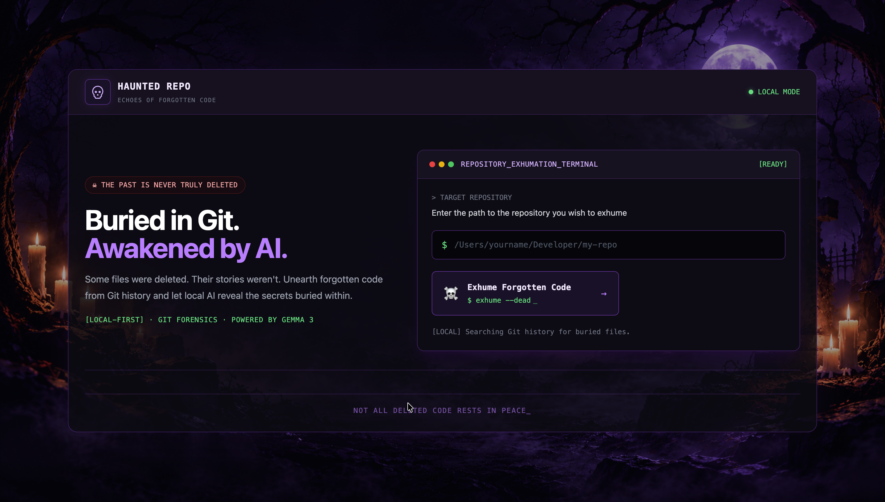
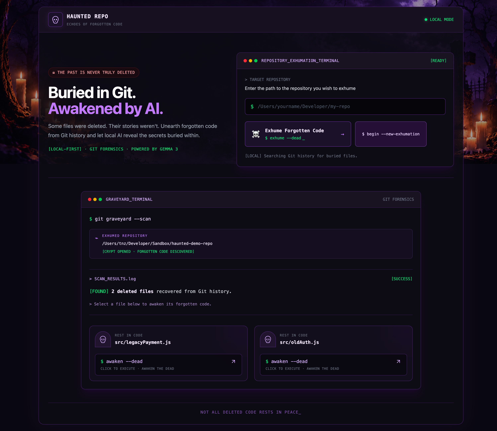
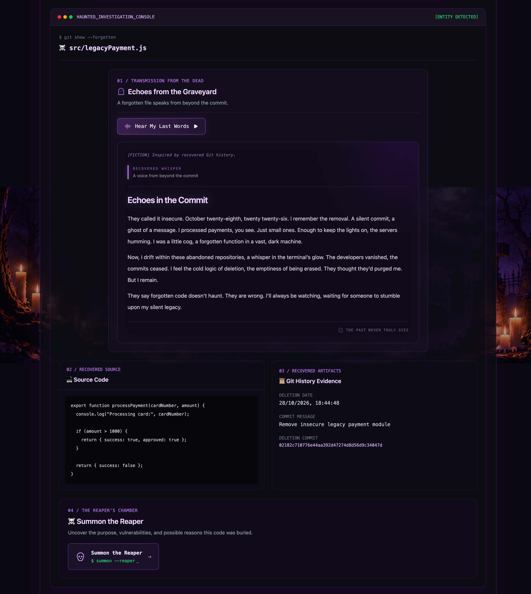
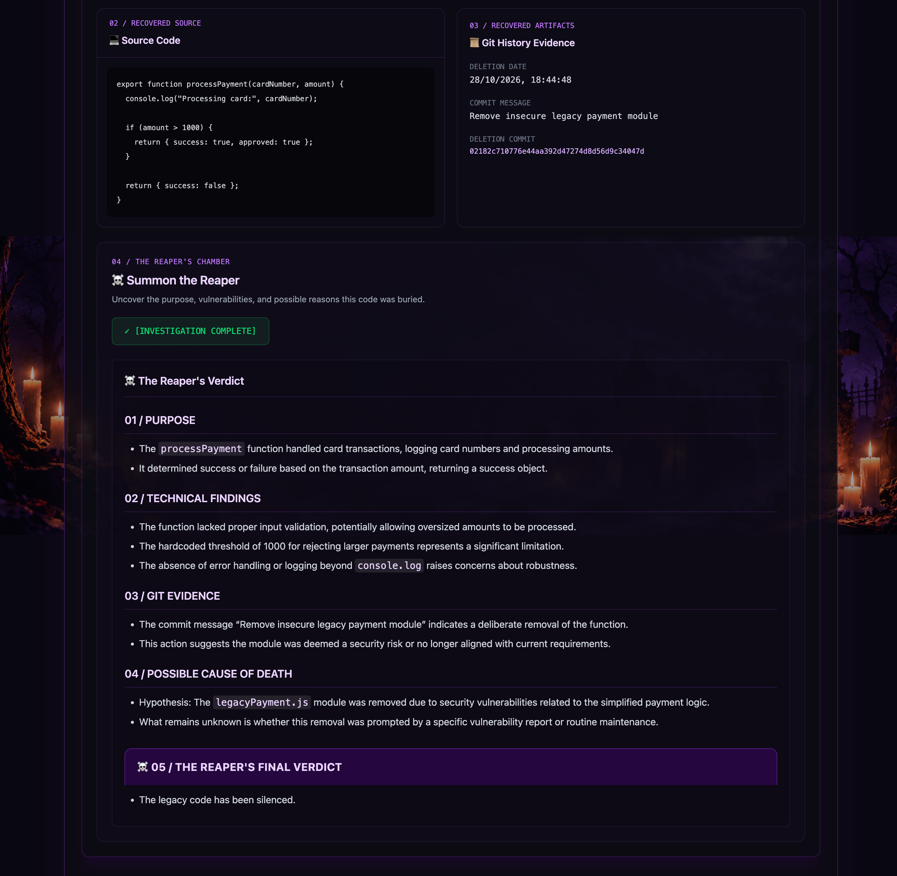

<div align="center">

# HAUNTED REPO

### Echoes of Forgotten Code

**THE PAST IS NEVER TRULY DELETED.**

**HACKTOBERFEST 2026 | WEEK 4 — GHOST IN THE MACHINE**


</div>

---

## What if deleted code could speak?

**Git remembers. Haunted Repo gives it a voice.**

Haunted Repo is a **local AI-powered developer tool** that uncovers deleted files from Git history and brings them back to life through storytelling, voice narration, and technical analysis.

| Discover                          | Resurrect                           | Investigate                            |
| --------------------------------- | ----------------------------------- | -------------------------------------- |
| Find deleted files in Git history | Generate ghost stories with Gemma 3 | Analyze recovered code with AI         |
| Recover historical source code    | Hear the ghost narrate its story    | Examine potential technical weaknesses |

**Built with:** React · Node.js · Express · Git · Gemma 3 4B · Ollama

---

## See Haunted Repo in Action

### 01 — Enter the Graveyard

**Every repository has a past. Some files never made it out alive.**

Scan a local Git repository and discover files that have disappeared from the current codebase.



### 02 — Meet the Forgotten Files

Browse the deleted files discovered in Git history and select one to investigate.



### 03 — Hear the Ghost's Story

**Deleted from the repository. Not from memory.**

Let Gemma 3 transform recovered source code into a fictional story told by the forgotten file itself.



### 04 — Face the Reaper's Verdict

**Every ghost has a story. Every piece of code has a history worth examining.**

Switch from storytelling to a technical investigation of the recovered code.



---

## Features

### 01. Repository Scanner

**Find what your Git history has been hiding.**

- **Local repository scanning** — Enter an absolute path to a Git repository.
- **Git-based discovery** — Identify files deleted throughout the repository's history.
- **Interactive exploration** — Browse discovered files in the graveyard.
- **File selection** — Choose a deleted file for further investigation.

### 02. Graveyard of Deleted Files

**Not every deleted file rests in peace.**

- **Forgotten files, rediscovered** — Explore deleted files recovered from Git history.
- **Interactive graveyard** — Select files and uncover their available historical evidence.
- **Individual investigations** — Every file can become the subject of a ghost story or technical verdict.

### 03. Git History & Code Recovery

**The evidence comes from Git. Not from AI guesses.**

Before generating anything, Haunted Repo retrieves historical information directly from the repository.

- **Source recovery** — Retrieve available historical file contents.
- **Code inspection** — Examine the implementation that existed before deletion.
- **Git evidence** — Use available repository history as context for AI generation.

**Why this matters:** Gemma receives real source code and historical context rather than being asked to invent a file's contents.

### 04. The Ghost's Story — Powered by Gemma 3

**Every deleted file deserves one last confession.**

What if an abandoned authentication module could tell the story of its own disappearance?

Haunted Repo uses **Gemma 3 4B** to create fictional narratives inspired by recovered code.

- **Context-aware storytelling** — Stories are generated using the selected file's recovered contents.
- **First-person ghost narratives** — Forgotten code gets a fictional voice.
- **Local inference** — Generation runs through Ollama on the developer's machine.
- **File-specific results** — Different recovered files provide different context for the model.

**The twist:** Git tells us what survived in history. Gemma imagines what the forgotten code might say.

### 05. Hear My Last Words — Ghost Narration

**The ghost doesn't just leave a message. It speaks.**

- **Voice narration** — The browser's Web Speech API reads generated ghost stories aloud.
- **Atmospheric sound effects** — Audio enhances the haunted experience.
- **Browser-based speech** — No hosted text-to-speech API is required.

**Behind the scenes:** Gemma writes the story. The browser gives it a voice.

### 06. The Reaper's Verdict — Technical Investigation

**Enough ghost stories. Time for the code review.**

Haunted Repo switches from creative storytelling to technical interpretation using the same Gemma 3 model.

- **Likely purpose** — Understand what the deleted file was designed to do.
- **Implementation analysis** — Examine the recovered code's structure and behavior.
- **Potential weaknesses** — Identify issues that may deserve closer inspection.
- **Technical verdict** — Generate an AI interpretation based on the available source code.

**Important:** The verdict is AI-generated and should not be treated as a confirmed explanation of why a file was deleted.

### 07. Haunted Interface

**Git archaeology, with a darker atmosphere.**

- **Responsive frontend** — Built using React, Vite, and Tailwind CSS.
- **Interactive graveyard** — Explore deleted files visually.
- **Dedicated story and verdict experiences** — Switch between creative and technical investigation.
- **Atmospheric visuals and audio** — Reinforce the Halloween theme without distracting from the developer experience.

---

## How It Works

**From a deleted file to a story worth hearing.**

| Step   | Action   | Behind the Scenes                                                  |
| ------ | -------- | ------------------------------------------------------------------ |
| **01** | Scan     | Enter the absolute path to a local Git repository.                 |
| **02** | Discover | The Express backend uses Git commands to identify deleted files.   |
| **03** | Recover  | Retrieve available historical source code and Git evidence.        |
| **04** | Generate | Gemma 3 creates a ghost story or technical verdict through Ollama. |
| **05** | Narrate  | The browser reads the generated story aloud.                       |

### Under the Hood

**Git handles discovery and recovery. Gemma handles interpretation.**

The application uses two task-specific prompts:

| AI Task                            | Purpose                                                                            |
| ---------------------------------- | ---------------------------------------------------------------------------------- |
| **Ghost Story Prompt**             | Transform recovered source code and historical context into a fictional narrative. |
| **Technical Investigation Prompt** | Interpret the recovered code's purpose, structure, and potential weaknesses.       |

**Model:** `gemma3:4b`  
**Runtime:** Ollama  
**Inference:** Local machine  
**Backend:** Node.js + Express

---

## Why Gemma 3?

### One Model. Two Very Different Personalities.

Gemma 3 isn't an optional chatbot attached to Haunted Repo. It powers the project's two central AI experiences.

|              | The Ghost's Story              | The Reaper's Verdict           |
| ------------ | ------------------------------ | ------------------------------ |
| **Goal**     | Creative storytelling          | Technical investigation        |
| **Input**    | Recovered code and Git context | Recovered code and Git context |
| **Output**   | Fictional narrative            | Technical interpretation       |
| **AI Model** | Gemma 3 4B                     | Gemma 3 4B                     |
| **Runtime**  | Ollama                         | Ollama                         |

### Why Run Gemma Locally?

**Open-weight AI is central to how Haunted Repo works.**

- **Privacy first** — Recovered source code can be processed without uploading it to a hosted AI provider.
- **Offline inference** — Once Ollama and Gemma are installed, generation can run without an internet connection.
- **No per-request API fees** — AI inference uses local computing resources.
- **Developer control** — Prompts and model configurations can be modified.
- **Model flexibility** — Developers can experiment with other compatible local models.
- **Open innovation** — The AI experience can be developed and customized without depending on a proprietary hosted inference API.

**The advantage:** Developers retain control over their repository data and inference environment.

---

## Tech Stack

| Layer                   | Technologies                          |
| ----------------------- | ------------------------------------- |
| **Frontend**            | React, Vite, Tailwind CSS, JavaScript |
| **Backend**             | Node.js, Express                      |
| **Repository Analysis** | Git CLI                               |
| **AI Model**            | Google Gemma 3 4B                     |
| **Local AI Runtime**    | Ollama                                |
| **Voice Narration**     | Web Speech API                        |
| **Sound Effects**       | Browser audio playback                |

---

## Getting Started

### Prerequisites

| Requirement       | Purpose                                 |
| ----------------- | --------------------------------------- |
| **Node.js + npm** | Run the frontend and backend            |
| **Git**           | Access repository history               |
| **Ollama**        | Run local AI inference                  |
| **Gemma 3 4B**    | Generate stories and technical verdicts |

### 1. Clone the Repository

```bash
git clone YOUR_GITHUB_REPOSITORY_URL
cd haunted-repo
```

Replace `YOUR_GITHUB_REPOSITORY_URL` with your actual GitHub clone URL.

### 2. Install Gemma 3

Install Ollama from [ollama.com](https://ollama.com).

Download the model:

```bash
ollama pull gemma3:4b
```

Make sure Ollama is running before starting the application.

### 3. Configure the Backend

From the project root:

```bash
cd server
npm install
```

Create a `.env` file inside the `server/` directory:

```env
PORT=3000
OLLAMA_URL=http://localhost:11434
OLLAMA_MODEL=gemma3:4b
```

Start the backend:

```bash
npm run dev
```

**Backend:** `http://localhost:3000`

### 4. Start the Frontend

Open a new terminal from the project root:

```bash
cd client
npm install
npm run dev
```

**Frontend:** Open the development URL displayed by Vite, usually `http://localhost:5173`.

### 5. Scan a Repository

Enter the absolute path to a local Git repository.

**Example test repository:**

```text
/Users/tnz/Developer/Sandbox/haunted-demo-repo
```

**Note:** This is a local example path from the development environment. Replace it with a repository path on your own machine.

For meaningful results, use a repository containing files that were previously committed and subsequently deleted.

Then:

1. **Scan** the repository.
2. **Select** a deleted file from the graveyard.
3. **Explore** its recovered code and available Git history.
4. **Generate** a ghost story or technical verdict.
5. **Listen** to the ghost story using browser narration.

---

## Technical Considerations & Limitations

| Area                    | What to Know                                                                     |
| ----------------------- | -------------------------------------------------------------------------------- |
| **Git evidence**        | Historical recovery depends on Git data still available in the repository.       |
| **AI accuracy**         | Ghost stories are fictional, and technical verdicts may contain inaccuracies.    |
| **Local access**        | The backend can only scan repositories accessible through its filesystem.        |
| **Remote repositories** | Direct GitHub repository scanning and cloud uploads are not currently supported. |
| **Performance**         | AI generation speed depends on hardware, model size, and prompt length.          |
| **Narration**           | Speech voices and playback behavior depend on the browser and operating system.  |
| **Security**            | Only scan repositories you are authorized to access.                             |

---

## Hacktoberfest 2026

### Ghost in the Machine — Week 4

**Challenge:** DEV Hacktoberfest 2026  
**Theme:** Ghost in the Machine  
**Partner Prize Category:** Best Use of Gemma

Haunted Repo brings the theme to life through a developer-focused experience:

- **The past** — Recover deleted files from Git history.
- **The haunting** — Generate fictional ghost stories about forgotten source code.
- **The voice** — Narrate those stories through browser speech synthesis.
- **The investigation** — Use Gemma 3 to analyze recovered implementations.
- **The open approach** — Run an open-weight AI model locally through Ollama.

**Why Gemma matters:** Gemma 3 powers both the creative and technical experiences at the heart of Haunted Repo.

---

## Project Status

**Functional local application — Hacktoberfest 2026 challenge project.**

### Potential Improvements

- Richer Git history visualizations.
- Support for additional local AI models.
- More detailed technical investigation capabilities.

---

_Some code gets refactored. Some gets replaced. And some refuses to rest in peace._
